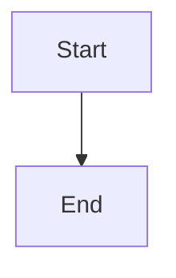

# Writing Conventions

This guide defines how Markdown content on this site should be written, keeping the directory structure, code blocks, diagrams and formulas consistent.

## Directories and Files

- Group notes by technology stack: `java/`, `spring-boot/`, `database/`. Create a same-named directory under `docs/` for a new topic.
- The home page of each directory is `index.md`, mapped to the "Overview" entry in the sidebar.
- File names use lowercase English and hyphens, for example `spring-boot-auto-config.md`.
- Put the page title in the level-one heading (`# Title`); do not repeat it in the frontmatter.

## Code Blocks

- Code blocks must be tagged with a language for syntax highlighting:

````md
```java
public void hello() {}
```
````

- Common language tags: `java`, `bash`, `sql`, `yaml`, `json`, `text`.
- Line numbers are shown by default; note the purpose of a longer example in the code block title if needed.

## Tables

- Use GFM tables with a complete header and separator row, and concise column names:

```md
| Column A | Column B |
| --- | --- |
| Content | Content |
```

## Formulas (LaTeX)

- Wrap inline formulas in a single `$`: `$E = mc^2$`.
- Wrap block formulas in `$$` as a standalone paragraph:

```md
$$
\int_0^1 x^2 \, dx = \frac{1}{3}
$$
```

## Mermaid Diagrams

- Use `mermaid` code blocks for flowcharts and sequence diagrams:

````md

````

- Common types: `flowchart`, `sequenceDiagram`.

## Images and Links

- Place static images under `docs/public/` and reference them with a leading `/`, for example `/images/demo.png`.
- Internal links use clean URLs, for example `/en/java/`, without the `.html` suffix.

## Writing Style

- Focus on one topic per article; open with one or two sentences stating the goal and intended readers.
- Lead with the conclusion or an example, then expand on the principles; avoid long unbroken paragraphs.
- Keep the original English term when a proper noun first appears.
