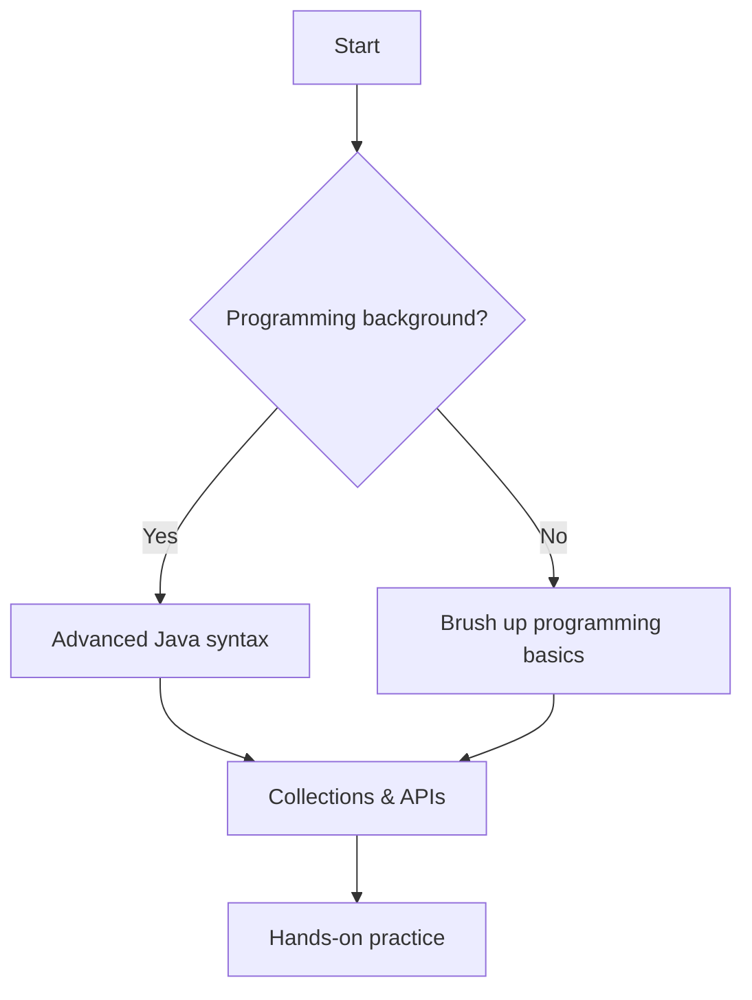
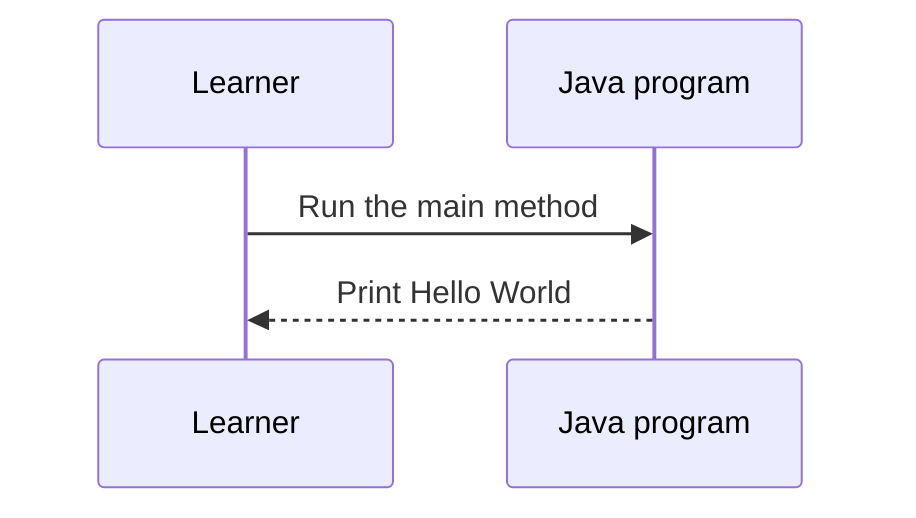

# Java Overview

> This page is a sample showing how code blocks, tables, LaTeX formulas and Mermaid diagrams are written. Real notes will be built on top of it.

## Introduction

Java is a statically typed, object-oriented programming language featuring platform independence, automatic garbage collection and a mature ecosystem. A suggested learning path starts with syntax basics and collections, moves on to concurrency, and gradually reaches the JVM and engineering practice.

## Code Example

```java
public class HelloWorld {

    public static void main(String[] args) {
        System.out.println("Hello, Madongdong!");
    }
}
```

## Common Collections Comparison

| Collection | Ordered | Duplicates allowed | Thread-safe | Typical use case |
| --- | --- | --- | --- | --- |
| ArrayList | Yes | Yes | No | Random access, iteration |
| LinkedList | Yes | Yes | No | Frequent inserts and deletes |
| HashMap | No | Keys unique | No | Key-value cache |
| TreeMap | Sorted by key | Keys unique | No | Sorted key lookup |

## Formulas

Inline formula: the mass–energy equation $E = mc^2$.

Block formula:

$$
\int_0^1 x^2 \, dx = \frac{1}{3}
$$

## Learning Path Flowchart



## Program Sequence Diagram


