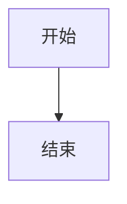

# 写作规范

本指南约定本站 Markdown 内容的编写方式，保证目录结构、代码块、图表与公式风格统一。

## 目录与文件

- 按技术栈分目录：`java/`、`spring-boot/`、`database/`，新增主题时在 `docs/` 下新建同名目录。
- 每个目录首页为 `index.md`，对应侧边栏「概述」入口。
- 文件名使用小写英文与连字符，例如 `spring-boot-auto-config.md`。
- 页面标题写在正文一级标题（`# 标题`），不要在 frontmatter 中重复。

## 代码块

- 代码块必须标注语言，便于高亮：

````md
```java
public void hello() {}
```
````

- 常用语言标识：`java`、`bash`、`sql`、`yaml`、`json`、`text`。
- 代码块默认显示行号；较长示例可在代码块标题中注明用途。

## 表格

- 使用 GFM 表格，表头与分隔行齐全，列名简洁：

```md
| 列 A | 列 B |
| --- | --- |
| 内容 | 内容 |
```

## 公式（LaTeX）

- 行内公式用单个 `$` 包裹：`$E = mc^2$`。
- 块级公式用 `$$` 包裹，单独成段：

```md
$$
\int_0^1 x^2 \, dx = \frac{1}{3}
$$
```

## Mermaid 图

- 流程图、序列图使用 `mermaid` 代码块：

````md

````

- 常用类型：`flowchart`（流程图）、`sequenceDiagram`（序列图）。

## 图片与链接

- 静态图片放在 `docs/public/` 下，引用时以 `/` 开头，例如 `/images/demo.png`。
- 站内链接使用 clean URL，例如 `/java/`，无需写 `.html` 后缀。

## 写作约定

- 一篇文章聚焦一个知识点，开头用一两句话说明目标与适用读者。
- 先给结论或示例，再展开原理；避免大段无分段文字。
- 专有名词首次出现时可附英文原文。
