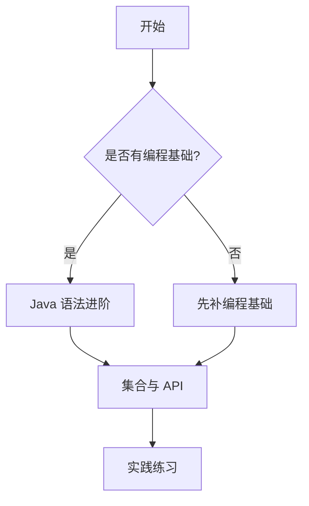
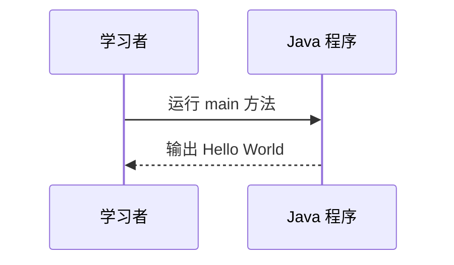

# Java 概述

> 本页为样板示例，演示代码块、表格、LaTeX 公式与 Mermaid 图的写法，正式内容在此基础上补充。

## 简介

Java 是一门面向对象的静态类型编程语言，具备跨平台、自动垃圾回收、成熟生态等特点。学习路线建议从语法基础、集合框架、并发编程，逐步过渡到 JVM 与工程实践。

## 代码示例

```java
public class HelloWorld {

    public static void main(String[] args) {
        System.out.println("Hello, Madongdong!");
    }
}
```

## 常用集合对比

| 集合 | 是否有序 | 是否允许重复 | 线程安全 | 典型场景 |
| --- | --- | --- | --- | --- |
| ArrayList | 是 | 是 | 否 | 随机访问、遍历 |
| LinkedList | 是 | 是 | 否 | 频繁插入删除 |
| HashMap | 否 | key 不重复 | 否 | 键值缓存 |
| TreeMap | 按 key 排序 | key 不重复 | 否 | 需要排序的键值 |

## 公式示例

行内公式：质能方程 $E = mc^2$。

块级公式：

$$
\int_0^1 x^2 \, dx = \frac{1}{3}
$$

## 学习路线流程图



## 程序运行序列图


